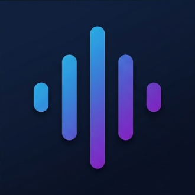
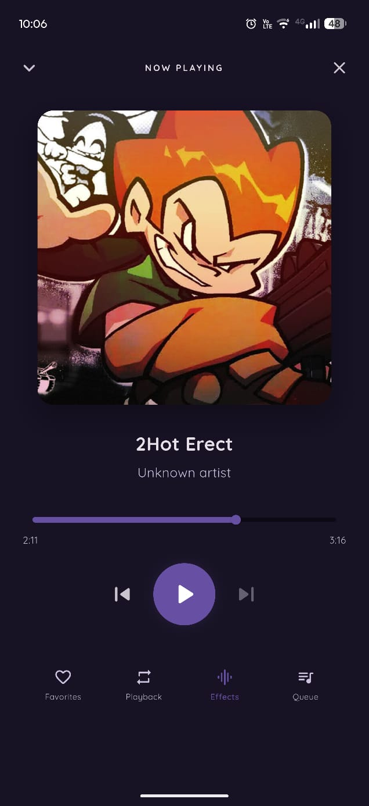
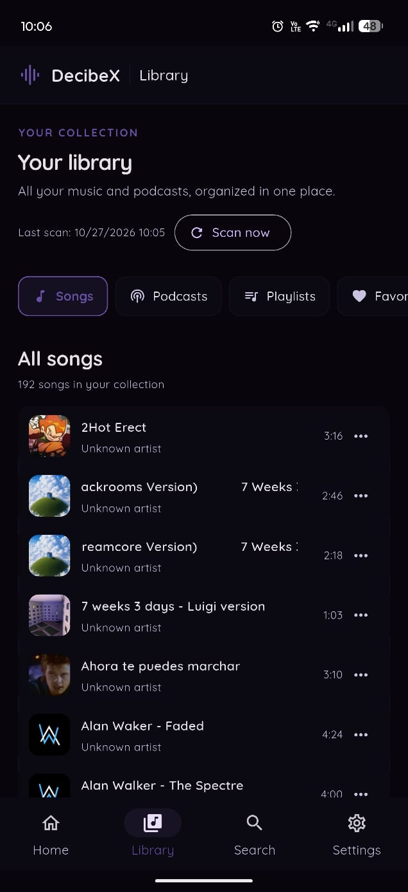
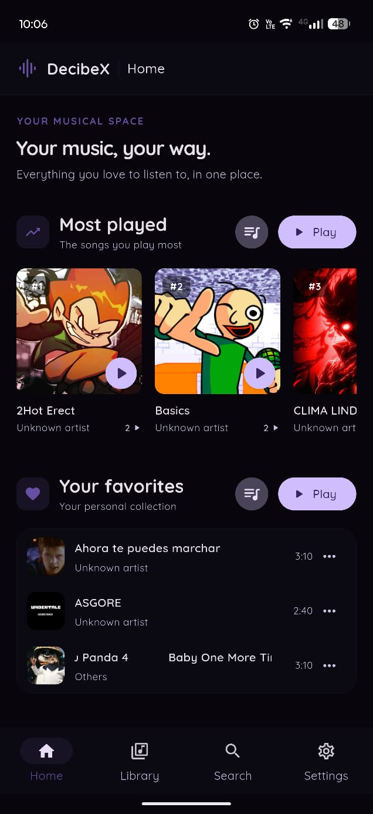
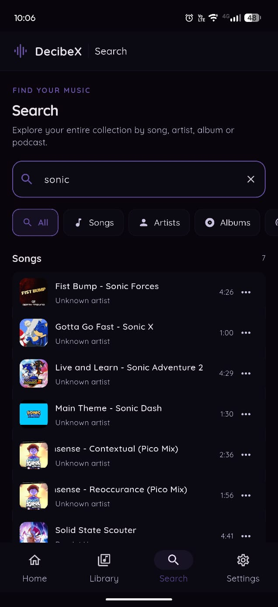
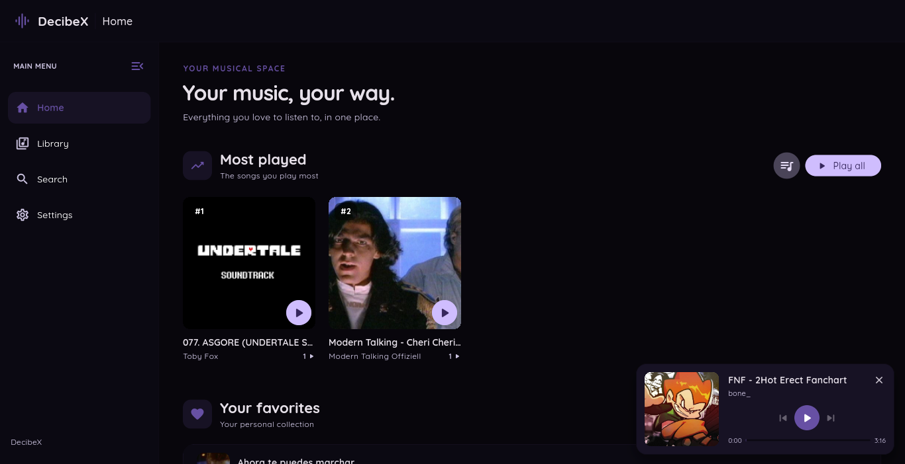
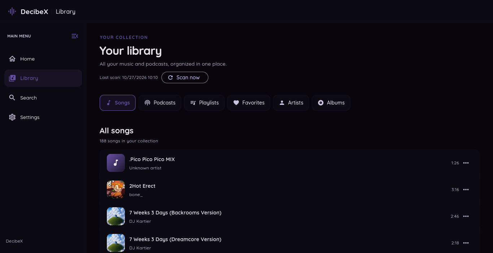
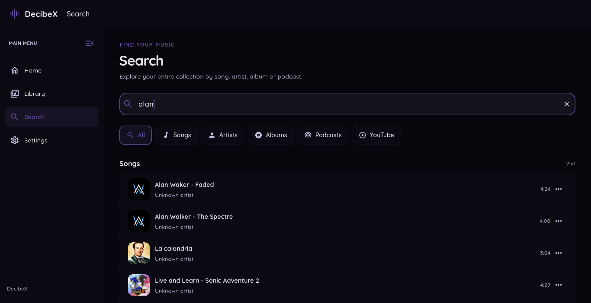
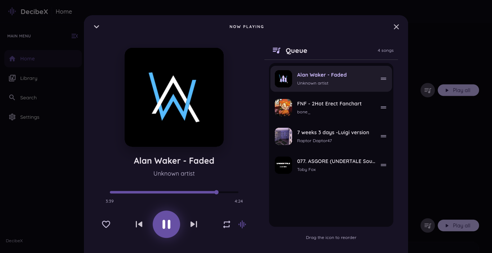

# DecibeX

<p align="center">
  
</p>

<h1 align="center">DecibeX</h1>

<p align="center">
  <strong>Your music. Your library. Your experience.</strong>
</p>

<p align="center">
  Un reproductor de música multiplataforma creado con Flutter.
</p>

<p align="center">
  
  
  
  
</p>

---

## About

**DecibeX** is a music player designed to provide a clean, customizable interface and a convenient way to organize and enjoy your local music collection.

Built with Flutter and Dart, DecibeX aims to deliver a consistent experience across mobile and desktop platforms.

## Screenshots

### Android

<p align="center">
  
  
  
  
</p>

### Desktop

<p align="center">
  
  
  
  
</p>

## Features

- **Music Library** — Scan and organize your local audio collection.
- **Playlists** — Create and manage custom playlists.
- **Audio Playback** — Playback controls, queue management, shuffle and repeat.
- **Favorites** — Keep your favorite tracks close at hand.
- **Search** — Find music in your collection.
- **YouTube Integration** — Search for videos and explore download functionality.
- **Customization** — Dark mode and customizable accent colors.
- **Cross-platform** — Designed for Android, Linux and Windows.

## Tech Stack

| Technology | Purpose |
|---|---|
| [Flutter](https://flutter.dev/) | Cross-platform UI framework |
| [Dart](https://dart.dev/) | Programming language |
| [just_audio](https://pub.dev/packages/just_audio) | Audio playback |
| [media_kit](https://pub.dev/packages/media_kit) | Desktop media support |

## Getting Started

### Prerequisites

- Flutter SDK
- Dart SDK
- Android Studio or Visual Studio Code
- Platform-specific build tools

### Installation

Clone the repository:

```bash
git clone https://github.com/YOUR_USERNAME/DecibeX.git
cd DecibeX
```

Install dependencies:

```bash
flutter pub get
```

Run the application:

```bash
flutter run
```

### Build

Android APK:

```bash
flutter build apk --release
```

Linux:

```bash
flutter build linux --release
```

Windows:

```bash
flutter build windows --release
```

## Project Structure

```text
decibex/
├── android/
├── linux/
├── windows/
├── lib/
├── pictures/
│   ├── an1.png
│   ├── an2.png
│   ├── an3.png
│   ├── an4.png
│   ├── icon.png
│   ├── pc1.png
│   ├── pc2.png
│   ├── pc3.png
│   └── pc4.png
├── pubspec.yaml
└── README.md
```

## Roadmap

- [x] Cross-platform Flutter foundation
- [x] Local music library
- [x] Playback queue and controls
- [x] Playlists and favorites
- [x] Theme customization
- [ ] Improve YouTube download support
- [ ] Further performance and UI improvements

## Contributing

Suggestions, bug reports and contributions are welcome. Feel free to open an issue to discuss ideas or report problems.

## License

No license has been specified yet.
